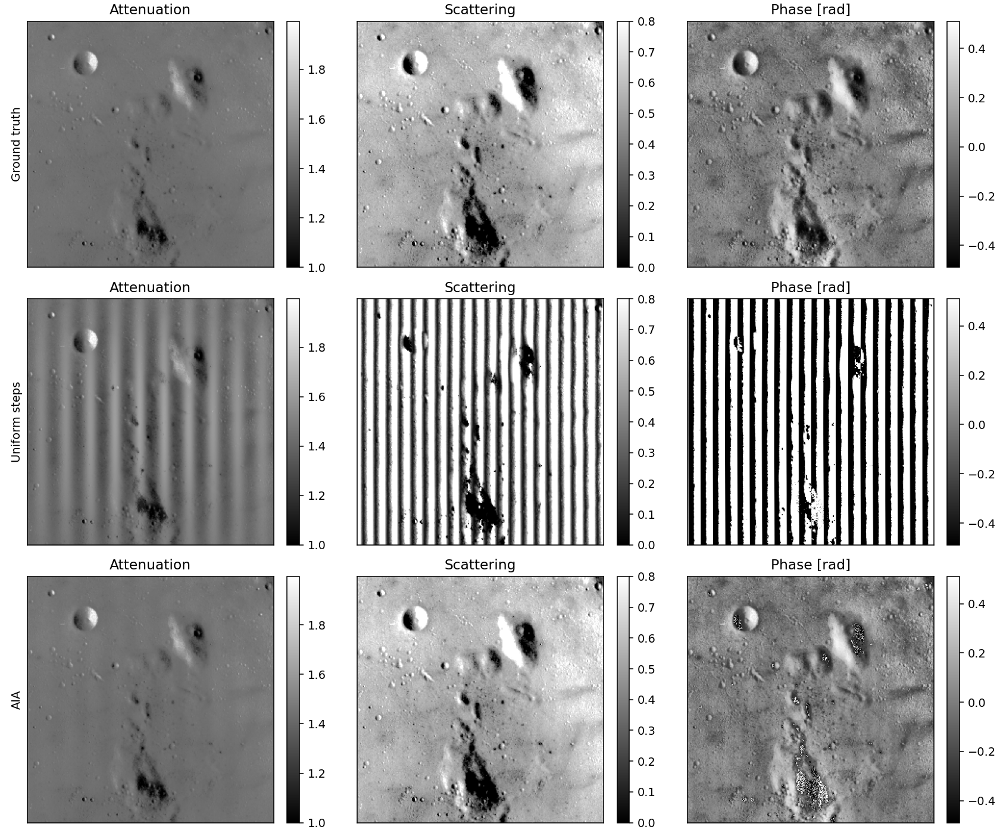
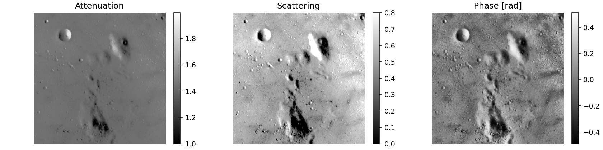
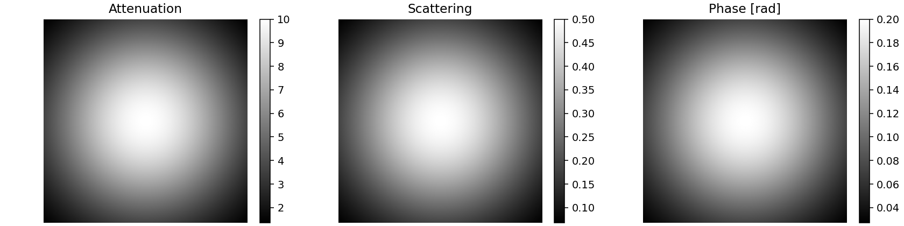
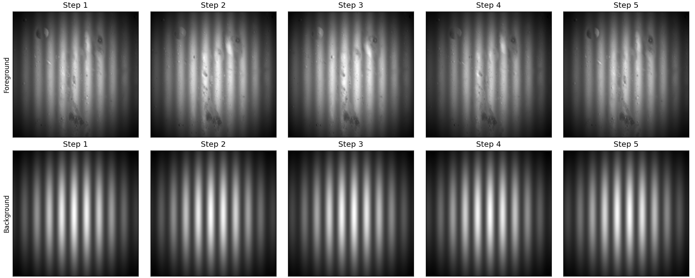

# AIA: ランダムな位相シフトからの位相抽出

Advanced Iterative Algorithm（AIA）を使い、位相シフト量が等間隔でない干渉画像から、平均強度・縞の変調度・位相を推定するPython実装です。数式とシミュレーション結果はこのREADMEで読めます。図を再現したり条件を変えたりするときだけPythonを実行します。

原論文：Wang, Z., & Han, B. (2004). *Advanced iterative algorithm for phase extraction of randomly phase-shifted interferograms*. Optics Letters, 29(14), 1671. [DOI: 10.1364/OL.29.001671](https://doi.org/10.1364/OL.29.001671)

## 結果を先に見る

上から真値、位相シフトが等間隔だと仮定する方法、AIAによる復元です。同じ列には真値と同じカラースケールを使っています。表示範囲外の値は白・黒に飽和します。



この例では、等間隔法に現れる周期的な縞の誤差がAIAで減ります。ただし、位相の復元には誤差や局所的な不連続が残っています。完全な復元や、任意の位相シフト条件での収束を保証する実装ではありません。

## 再現する

Python 3.12以降と[uv](https://docs.astral.sh/uv/)を使用します。

```sh
git clone https://github.com/uedasan/AIA.git
cd AIA
uv run --locked python demo.py
```

`results/` に4枚のPNGと `metrics.json` を保存します。画面表示やJupyterサーバーの起動は不要です。

```sh
# READMEの図を再生成
uv run --locked python demo.py --output-dir docs/images

# 等間隔の位相シフトと比較
uv run --locked python demo.py --step-error 0 --output-dir results/uniform

# 位相シフト枚数・乱数を変更し、復元配列も保存
uv run --locked python demo.py --steps 7 --seed 42 --save-arrays
```

| 引数 | 既定値 | 意味 |
| --- | --- | --- |
| `--output-dir` | `results` | 図と誤差の保存先 |
| `--seed` | `12345` | 位相シフト誤差を生成する乱数のシード |
| `--steps` | `5` | 前景・背景それぞれの干渉画像枚数（3以上） |
| `--kx` | `10` | 画像幅あたりの搬送縞の周期数 |
| `--step-error` | `1.0` | 位相シフト誤差の標準偏差［rad］ |
| `--save-arrays` | 指定なし | 前景・背景の画像スタックとAIA復元値をNPZにも保存 |

## 干渉画像のモデル

位置 $(x,y)$、撮影番号 $k$ の強度を次で表します。

$$
I_k(x,y)=A(x,y)\{1+S(x,y)\cos[\Phi(x,y)+\delta_k]\}.
$$

| 記号 | 意味 | コード中の名前 |
| --- | --- | --- |
| $A$ | 平均強度 | `atten` |
| $S$ | 平均強度で規格化した縞の変調度 | `scatt` |
| $\Phi$ | 物体の位相と搬送縞を合わせた位相［rad］ | `phase` と搬送縞の和 |
| $\delta_k$ | 画像全体に共通の位相シフト［rad］ | `phase_steps` / `pstep` |

元のNotebookに合わせて `atten`、`scatt` という名前を使っています。以下のデモの復元画像は、背景で規格化した平均強度比・変調度比と位相差です。吸収係数や散乱係数そのものへの換算は行いません。

位相シフトは、等間隔の値に正規乱数の誤差を加えて生成します。

$$
\delta_k=\frac{2\pi k}{N}+\eta_k,\qquad
\eta_k\sim\mathcal{N}(0,\sigma^2),\quad k=1,\ldots,N.
$$

デモでは $N=5$、$\sigma=1$ radです。前景と背景には、同じ乱数生成器から順に生成した別々の位相シフトを適用します。撮影ノイズは加えていません。

## シミュレーションの作り方

`scikit-image` の `data.moon()`（512 × 512画素）から、平均強度比・変調度比・平均を引いた位相を作ります。物理的な物体モデルではなく、既知の画像を使った数値例です。



背景にはガウス状の強度・変調度・位相分布を設定します。



物体の成分を $(A_o,S_o,\phi_o)$、背景を $(A_b,S_b,\phi_b)$ とすると、前景・背景の入力は次のようになります。$C(x)=2\pi k_x x/n_x$ は搬送縞です。

$$
(A_f,S_f,\Phi_f)=(A_oA_b,\ S_oS_b,\ \phi_o+\phi_b+C),
$$

$$
\Phi_b=\phi_b+C.
$$



## 等間隔を仮定する方法

位相シフトが $2\pi k/N$ だと仮定すると、DC成分と一次調和成分を計算できます。

$$
c_0=\frac{1}{N}\sum_k I_k,\qquad
c_1=\frac{2}{N}\sum_k I_k\exp(i2\pi k/N).
$$

モデルが仮定に一致すると、$c_0=A$、$c_1=AS\exp(-i\Phi)$ です。この複素指数の符号に合わせ、位相は $-\arg(c_1)$ で取り出します。実際の位相シフトが等間隔からずれると、この方法には周期的な誤差が生じます。

## AIAの反復

AIAは、物体の成分と位相シフトを交互に推定します。計算本体は [aia.py](aia.py) にあります。

1. **初期化**：位相シフト $\delta_k$ を等間隔で置きます。
2. **各画素の成分を推定**：$\delta_k$ を固定し、画像間で次の線形最小二乗問題を解きます。

   $$
   I_k=a+b\cos\delta_k+c\sin\delta_k.
   $$

   $A=a$、$S=\sqrt{b^2+c^2}/a$、$\Phi=\operatorname{atan2}(-c,b)$ として取り出します。

3. **各画像の位相シフトを推定**：$\Phi$ を固定し、画像内の画素を使って次を解きます。

   $$
   I_k=a_k+b_k\cos\Phi+c_k\sin\Phi.
   $$

   $\delta_k=\operatorname{atan2}(-c_k,b_k)$ として更新します。

4. **収束を判定**：先頭画像を基準にした相対位相シフトの変化を比較します。角度差は $[-\pi,\pi]$ に折り返し、その二乗和が `eps=1e-4` より小さく、最小反復数の条件も満たしたら終了します。最大反復数は30です。

この移行ではNotebookの最小二乗計算・初期化・終了条件を維持しています。既定の `n_iter_min=20` では、ループ添字に対する `i > n_iter_min` の条件により、早期終了は22回目からです。

## 背景を除いた復元値

前景・背景をそれぞれ独立に推定した後、次を計算します。

$$
\widehat A_o=\widehat A_f/\widehat A_b,\qquad
\widehat S_o=\widehat S_f/\widehat S_b,
$$

$$
\widehat\phi_o=\arg\{\exp(i\widehat\Phi_f)/\exp(i\widehat\Phi_b)\}.
$$

位相差からは画像全体の平均を引きます。絶対位相の定数オフセットはこのデモの評価対象に含めません。

既定パラメータでの真値に対するRMSE（全画素の二乗平均平方根誤差）は次のとおりです。位相は上記の折り返しと平均除去後の値を直接比較し、追加の位相合わせやアンラップはしていません。

| 復元方法 | 平均強度比 | 変調度比 | 位相［rad］ |
| --- | ---: | ---: | ---: |
| 等間隔法 | 0.073480 | 1.632291 | 1.175837 |
| AIA | 0.004765 | 0.010403 | 0.249558 |

このRMSEには、真値の変調度がゼロで位相を決められない画素も含めています。位相の不連続や平均除去の影響も含むため、縞が十分に見える領域だけの位相精度とは区別してください。

数値と生成条件は [metrics.json](docs/images/metrics.json) に保存しています。この1例の比較であり、精度の一般的な保証ではありません。

## 自分の画像に使う

`aia()` の入力形状は `(撮影枚数, 高さ, 幅)`、戻り値は平均強度・変調度・位相の3配列です。インポート時にデモ計算や描画は実行されません。

```python
import numpy as np
from aia import aia

images = np.load("interferograms.npy")
atten, scatt, phase = aia(images, progress=False)
np.savez("components.npz", attenuation=atten, scattering=scatt, phase=phase)
```

- 位相シフトは各画像内で共通と仮定しています。3枚以上でも、シフトが重なるなどの条件では最小二乗問題が特異になり、計算が失敗することがあります。
- 推定位相には定数オフセットや符号の曖昧さがあります。初期値やデータの条件によって結果が変わります。
- 位相は折り返した角度です。アンラップ、欠損画素のマスク、外れ値処理、撮影ノイズへの対策は実装していません。
- 平均強度や背景の変調度がゼロに近い領域では、除算が不安定になります。

## 構成と検証

| ファイル | 内容 |
| --- | --- |
| [aia.py](aia.py) | 干渉画像生成、等間隔法、AIAの計算関数 |
| [demo.py](demo.py) | サンプル画像、背景規格化、図と誤差の保存 |
| [docs/images/](docs/images/) | READMEに掲載する生成済みの図と誤差 |
| [tests/test_aia.py](tests/test_aia.py) | 解析解を使った計算のテスト |
| [docs/decisions/001-static-documentation.md](docs/decisions/001-static-documentation.md) | Notebookをやめた経緯と判断 |

```sh
uv sync --locked
uv run --locked python -m unittest discover -s tests -v
```
